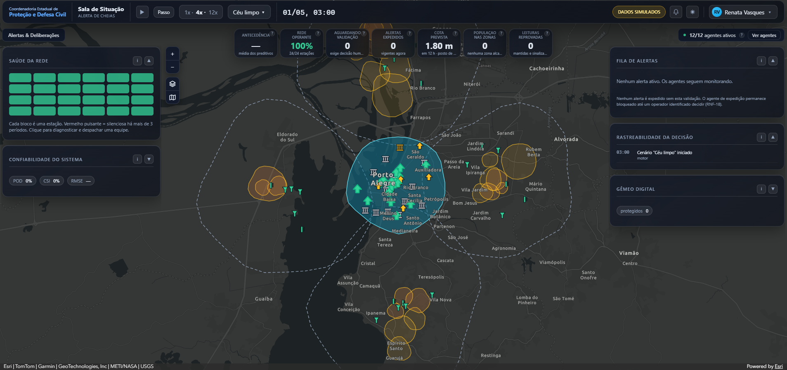
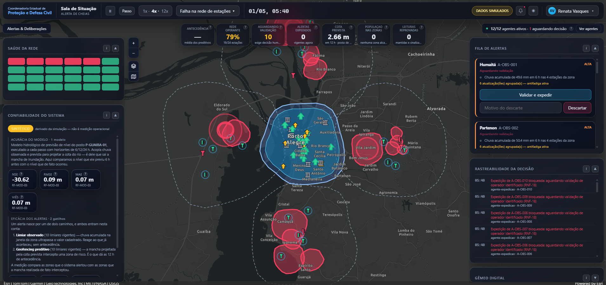
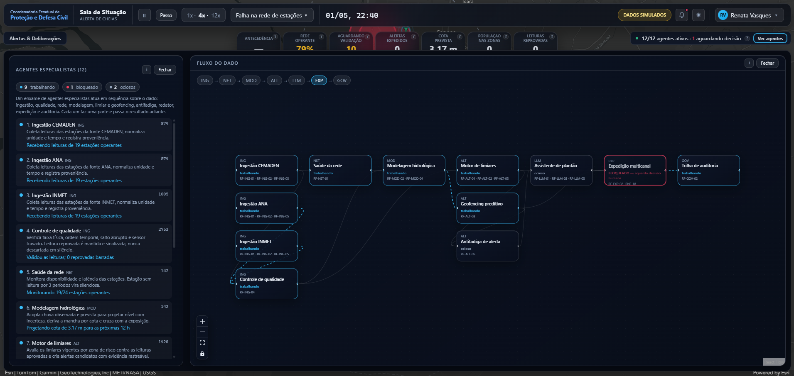
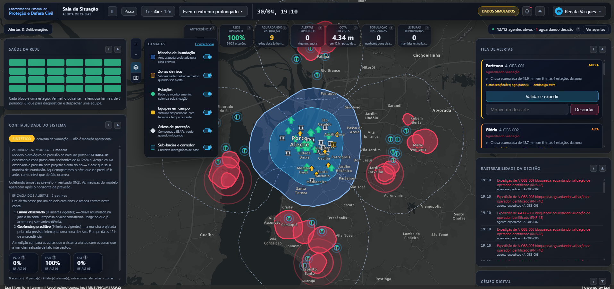

# Sala de Situação — Alerta Precoce de Cheias






## Catálogo da demonstração

| Campo | Informação |
| --- | --- |
| Autor | Rodolfo G. Lotte — Arquiteto de Negócios IA |
| Data | Outubro de 2026 |
| Destinatário original | Defesa Civil do Estado de São Paulo (Coordenadoria Estadual de Proteção e Defesa Civil) |
| Público de referência | Gestores públicos, equipes de defesa civil, hidrologia operacional, operações de monitoramento, TI/GIS e governança de dados territoriais |
| Indústria | Governo, gestão de risco de desastres, meteorologia e hidrologia operacional, infraestrutura hídrica, inteligência territorial e operação pública de alerta à população |
| Tipo | Demonstração interativa, ambiente simulado, frontend React/Vite com ArcGIS Maps SDK |
| Objetivo comercial | Apoiar conversas consultivas sobre sala de situação multi-agente, alerta precoce espacializado, gêmeo digital de bacia, governança da decisão e integração com ArcGIS Enterprise |
| Reaproveitamento | Clientes com responsabilidade por alerta à população, monitoramento hidrometeorológico, operação de bacias, plano de contingência, saneamento, infraestrutura hídrica e necessidade de decisão humana auditável |
| Status | Demonstração funcional com dados sintéticos reproduzíveis e basemap OpenStreetMap |

## Resumo

A Sala de Situação — Alerta Precoce de Cheias é uma demonstração interativa de uma plataforma de defesa civil para monitoramento hidrometeorológico, modelagem de risco e expedição de alertas, desenhada para simular como agentes de IA especialistas, especialistas digitais e analistas humanos poderiam trabalhar juntos em um fluxo público de alta responsabilidade. A aplicação apresenta uma sala de situação sobre uma bacia sintética, com mapa operacional sempre montado ao fundo, cabeçalho com relógio simulado e cenário controlado pelo operador, KPIs centralizados, fila de alertas aguardando validação humana, rastreabilidade da decisão, painéis de saúde da rede e confiabilidade do sistema (métricas NSE/RMSE/MAE/viés para o modelo e POD/FAR/CSI para os gatilhos), gêmeo digital com modo what-if para operar comportas e EBAPs, e um fluxo visível de doze agentes especialistas que percorrem ingestão, qualidade do dado, saúde da rede, modelagem hidrológica, limiares, geofencing preditivo, antifadiga, assistente de plantão, expedição multicanal e trilha de auditoria. O roteiro usa cinco cenários reprodutíveis em uma bacia fictícia inspirada em Porto Alegre (céu limpo, chuva convectiva localizada, evento extremo prolongado, falha na rede de estações e leitura implausível) para demonstrar situações de operação normal, alerta antecipado, degradação graciosa e controle de qualidade do dado. A proposta não é substituir a decisão técnica, mas mostrar um modelo de trabalho em que a IA organiza a telemetria, barra dados sujos, projeta a mancha de inundação, calcula o lead time, compõe o rascunho do boletim e expede somente após a validação explícita do operador identificado. Por ser uma demonstração, os dados, resultados, previsões, boletins e parte das geometrias são sintéticos ou simplificados, servindo como material de conversa para clientes de governo, defesa civil, infraestrutura hídrica, saneamento, agricultura, logística, mineração e demais setores que lidam com monitoramento, alerta precoce e grande volume de decisão sob pressão.

## Estrutura regularizada

Estrutura mínima para publicação na Vercel com o build do Vite:

```text
gov-sp-defesa-civil-sisgeo-pluvial/
  package.json
  package-lock.json
  vercel.json
  tsconfig.json
  vite.config.ts
  index.html
  .env.example
  .gitignore
  dist/
    assets/
    index.html
  src/
    agentes/
    dominio/
    estado/
    mapa/
    simulacao/
    styles/
    ui/
      paginas/
  pics/
```

Papel de cada parte:

- `gov-sp-defesa-civil-sisgeo-pluvial/package.json` e `package-lock.json`: scripts, dependências e metadados do projeto.
- `gov-sp-defesa-civil-sisgeo-pluvial/vercel.json`: configuração de deploy estático na Vercel (framework, build, rewrite de SPA, headers de segurança e branch de produção).
- `gov-sp-defesa-civil-sisgeo-pluvial/tsconfig.json` e `vite.config.ts`: tipagem TypeScript e configuração do bundler Vite.
- `gov-sp-defesa-civil-sisgeo-pluvial/index.html`: ponto de entrada do SPA.
- `gov-sp-defesa-civil-sisgeo-pluvial/.env.example`: variáveis opcionais para o modo ArcGIS Enterprise (ver "Conectar ao ArcGIS Enterprise").
- `gov-sp-defesa-civil-sisgeo-pluvial/dist/`: versão gerada para publicação após o build.
- `gov-sp-defesa-civil-sisgeo-pluvial/src/`: código-fonte, organizado por responsabilidade — `dominio/` lógica pura, `simulacao/` mundo procedural e motor de tick, `agentes/` os doze agentes especialistas, `estado/` ponte Zustand entre motor e React, `mapa/` camada ArcGIS Maps SDK, `styles/` tokens e CSS e `ui/` páginas e painéis.
- `gov-sp-defesa-civil-sisgeo-pluvial/pics/`: capturas de tela da demonstração usadas neste README.

## Últimas atualizações

- Doze agentes especialistas organizados em sete módulos (ING → NET → MOD → ALT → LLM → EXP → GOV), com atividade em linguagem natural visível na página Agentes & Fluxo.
- Cinco cenários reprodutíveis com semente fixa (céu limpo, chuva convectiva localizada, evento extremo prolongado, falha na rede de estações e leitura implausível).
- Validação humana obrigatória antes de qualquer expedição, garantida em código (RNF-18) e coberta por testes em três camadas (domínio, agente e motor ponta a ponta).
- Painel "Confiabilidade do sistema" com NSE/RMSE/MAE/viés para o modelo hidrológico e POD/FAR/CSI para os gatilhos de alerta, calculados sobre as séries da própria simulação e rotulados como sintéticos.
- Painel "Gêmeo digital" com modo what-if de comportas e EBAPs, recoloração dos ativos no mapa por estado e recálculo contínuo da população exposta por zona.
- Botões flutuantes de camadas (mancha de inundação, zonas de risco, estações, equipes em campo, ativos de proteção, sub-bacias e corredor) e troca de basemap (OSM, Satélite, Topográfico) sobre o mapa.
- Três páginas na navegação (Operacional, Agentes & Fluxo, Alertas & Deliberações) com o mapa ArcGIS sempre montado ao fundo.
- Terminologia operacional em português por padrão; o toggle "Modo técnico" (menu de perfil) revela os códigos de requisito `RF-…` para público técnico.
- Headers de segurança básicos (`X-Content-Type-Options`, `Referrer-Policy`, `Permissions-Policy`) habilitados no `vercel.json` para o deploy estático.

## Como rodar localmente

Requisitos:

- Node.js 20.x ou superior
- npm

Passos:

```bash
npm install
npm run dev
```

O servidor local do Vite exibirá a URL de acesso no terminal, normalmente `http://localhost:5173`.

Para gerar uma versão de produção:

```bash
npm run build
```

Para visualizar a versão gerada:

```bash
npm run preview
```

Para rodar os testes, a checagem de tipos e o build de uma vez antes de publicar:

```bash
npm run verificar
```

## Deploy

O projeto já inclui `vercel.json` com a configuração de deploy para Vercel:

- Framework: Vite
- Build: `npm run build`
- Saída: `dist`
- Rewrite de SPA: toda rota → `/index.html`
- Headers de segurança: `X-Content-Type-Options: nosniff`, `Referrer-Policy: strict-origin-when-cross-origin` e `Permissions-Policy` restritiva (`camera`, `microphone`, `geolocation`, `interest-cohort` desligados)
- `git.deploymentEnabled.main: true` — documenta `main` como branch de produção

Deploy sugerido na Vercel:

1. Em https://vercel.com/new, use *Import Git Repository* e selecione este repositório.
2. Garanta Node.js 20.x ou superior no ambiente de build (compatível com `engines.node` em `package.json`).
3. Mantenha o framework `vite` detectado automaticamente a partir do `vercel.json`.
4. Mantenha o comando de build como `npm run build` e a saída como `dist`.
5. Publique.

A partir desse vínculo inicial, o GitHub App do Vercel instala um webhook no repositório e passa a disparar deploy automaticamente a cada push: `main` → deploy de produção; demais branches e PRs → deploy de preview, com a URL comentada no PR pelo próprio GitHub App.

Também é possível hospedar a pasta `dist` em qualquer serviço de arquivos estáticos depois do build.

## Páginas da demonstração

### Operacional

Tela principal da simulação. Combina mapa operacional sobre a bacia sintética, cabeçalho com relógio simulado e cenário, KPIs centralizados (antecedência média, rede operante, aguardando validação, alertas expedidos, cota prevista, população nas zonas alcançadas e leituras reprovadas), botões flutuantes de camadas e basemap, painel de Saúde da rede, painel de Confiabilidade do sistema (métricas sintéticas rotuladas, com explicação do modelo e dos gatilhos medidos), resumo do enxame, Fila de alertas (onde a validação humana acontece), Rastreabilidade da decisão e Gêmeo digital com operação what-if de comportas e EBAPs.

### Agentes & Fluxo

Mostra os doze agentes especialistas organizados em sete módulos (ING, NET, MOD, ALT, LLM, EXP, GOV), cada um com descrição da atividade atual em linguagem natural — "Recebendo leituras de 19 estações operantes", "Projetando cota de 3,17 m para as próximas 12 h", "Validou as leituras; 0 reprovadas barradas", etc. — e o grafo visual do Fluxo do dado, da ingestão até a expedição multicanal e a trilha de auditoria. A página torna visível o bloqueio do agente de expedição enquanto o alerta aguarda validação humana (RNF-18).

### Alertas & Deliberações

Registra o histórico completo de alertas da operação: cada candidato gerado, qual zona foi alvo, severidade estimada, estado final (validado e expedido, descartado, ou aguardando), operador que decidiu, motivo da decisão, horários e o boletim gerado pelo agente redator. Serve para demonstrar rastreabilidade, prestação de contas e revisão posterior.

## Cenários abordados

- **Céu limpo** — sistema em repouso, rede saudável, nenhum alerta gerado; estado operacional de referência para falar de monitoramento 24/7.
- **Chuva convectiva localizada** — limiar observado dispara; o agente antifadiga agrupa a reincidência na mesma célula em vez de criar alerta novo, protegendo o plantão de ruído.
- **Evento extremo prolongado** — cota sobe, mancha de inundação cresce em direção às zonas de risco, geofencing preditivo antecipa o alerta com lead time, e a validação humana libera a expedição com o boletim gerado pelo redator.
- **Falha na rede de estações** — estações silenciam durante o evento; o painel de Saúde da rede expõe a lacuna, o KPI de rede operante cai e o sistema degrada graciosamente com o que resta.
- **Leitura implausível** — um sensor envia leitura absurda (ex.: 2000 mm/h); o agente de qualidade reprova, mantém o registro para auditoria e impede que o dado sujo vire alerta.

Todos os cenários usam a mesma semente de aleatoriedade e são **reprodutíveis**: mesmo cenário + play do zero → mesmo resultado em cada execução, viabilizando ensaio da apresentação.

## Conectar ao ArcGIS Enterprise

A demonstração funciona integralmente **sem** credencial. Para apontar para um portal ArcGIS Enterprise real, preencha o `.env` (ou as variáveis no host de publicação):

```
VITE_ARCGIS_PORTAL_URL=https://portal.exemplo.gov.br/portal
VITE_ARCGIS_APP_ID=<App ID registrado no portal>
VITE_MODO_ENTERPRISE=true
VITE_ARCGIS_BASEMAP_ID=<id de webmap do portal, opcional>
```

Passos no portal:

1. *Content > New item > Application > Other application* — registre a aplicação e anote o **App ID (Client ID)**.
2. Em *Settings > Redirect URIs*, cadastre `http://localhost:5173` (desenvolvimento) e a URL de produção. Sem isso, o fluxo OAuth falha silenciosamente no navegador.
3. Para consumir camadas do portal, troque os mocks de `src/simulacao/mundo.ts` por `FeatureLayer` apontando para seus serviços publicados. Para o basemap, substitua `Basemap.fromId("osm")` em `src/mapa/MapaSalaSituacao.tsx` por `new Basemap({ portalItem: { id: … } })`.

> `modoEnterprise()` só liga com **flag e App ID** presentes (ver `src/mapa/config.ts`), evitando que um deploy com a flag ligada e sem credencial quebre a apresentação. O contrato de dados esperado está nas interfaces de `src/dominio/tipos.ts` — mapeie os campos do serviço real em um adaptador, **não altere os tipos do domínio para caber no serviço**, porque isso propagaria o formato do serviço por toda a aplicação.

## Dados e limites

Esta demonstração usa dados sintéticos, resultados simulados e geometria de bacia gerada proceduralmente. Ela não deve ser usada para alerta real à população, decisão de evacuação, análise hidrológica oficial, validação meteorológica, certificação institucional ou conclusão técnica sobre eventos existentes. Três propriedades foram verificadas durante a construção e explicam por que a demonstração pode ser levada a um público técnico sem ressalvas escondidas:

- **O rascunho do boletim não é escrito por LLM.** O agente redator (`src/dominio/boletim.ts`) compõe o texto a partir de um template preenchido com valores já presentes no estado da simulação. Nenhum número aparece no boletim que não tenha sido lido de uma fonte da simulação — é honestidade deliberada, não um atalho por falta de chave de API.
- **A previsão de nível não é um modelo hidrológico.** É uma curva de resposta chuva-nível paramétrica (`src/dominio/previsao.ts`), suficiente para demonstrar o fluxo previsão → mancha → alerta espacial, mas que não substitui um modelo físico acoplado nem um modelo de aprendizado de máquina treinado em séries reais.
- **A validação humana obrigatória (RNF-18) é aplicada em código.** `expedir()` (`src/dominio/alerta.ts`) lança exceção se o alerta não estiver validado por um operador identificado; nenhuma expedição automática existe no código de produção. Testes cobrem isso em três camadas: domínio, agente e motor ponta a ponta.

A ferramenta serve como material de demonstração e conversa sobre desenho de produto, arquitetura de IA aplicada a defesa civil, alerta precoce espacializado, gêmeo digital de bacia, governança da decisão e integração com ArcGIS Enterprise.
